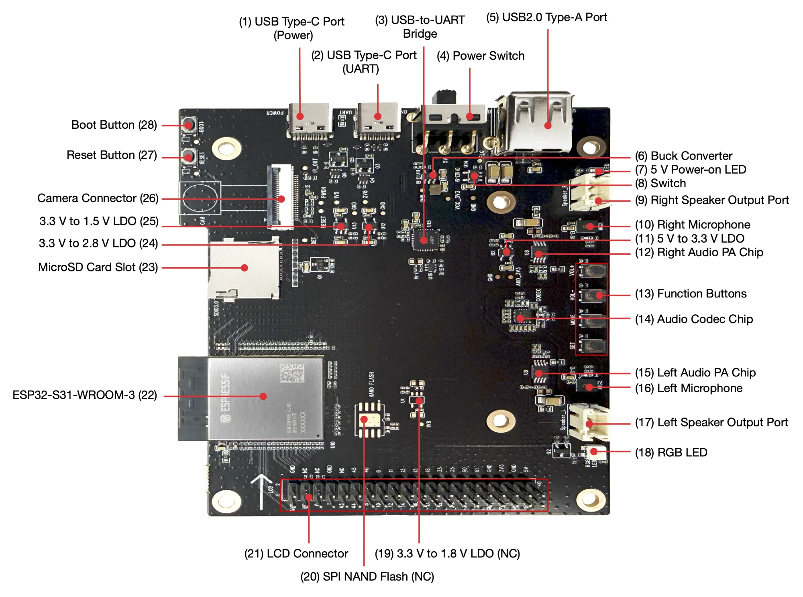
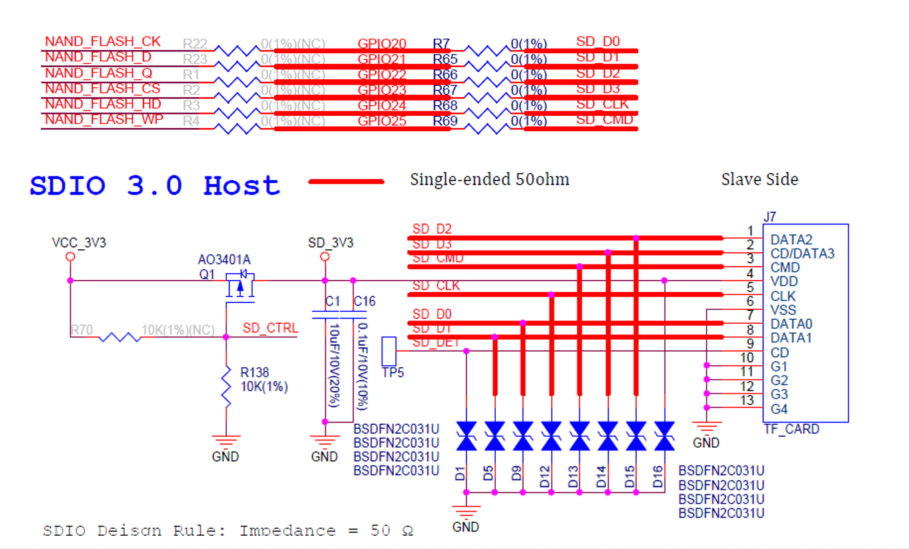

[한국어](README.md) | **English**

# ESP32-S31-Korvo-1 microSD USB High-Speed MSC Speed Test

Exposes the microSD card of the ESP32-S31-Korvo-1 to a PC as a USB 2.0 High-Speed mass storage device (MSC).
Measures the read and write speed in that setup. exFAT on SDXC cards of 64 GB and larger is supported.

## Web Flasher

**<https://firepooh.github.io/ESP32S31-SDCARD/>**

1. Open it in desktop Chrome or Edge.
2. Connect the Korvo-1 Type-C UART port to the PC.
3. Pick a version and press **Connect** → **Flash**.

Binaries and esptool commands are on the [Releases](https://github.com/firepooh/ESP32S31-SDCARD/releases) page.

## Board

| Item | Details |
|---|---|
| Board | [ESP32-S31-Korvo-1 V1.1](https://docs.espressif.com/projects/esp-dev-kits/en/latest/esp32s31/esp32-s31-korvo-1/user_guide.html) (ESP32-S31-WROOM-3, 16 MB flash, 16 MB PSRAM) |
| SD card | microSDXC 64 GB or larger, exFAT (FAT32 also works) |
| Toolchain | ESP-IDF v6.1, esp_tinyusb 2.2.0 |



| No. | Part | Use |
|---|---|---|
| (2) | USB Type-C port (UART) | Power, flashing, console (COM port) |
| (4) | Power switch | Board 5 V power |
| (5) | USB 2.0 Type-A port | USB High-Speed MSC (to the PC) |
| (22) | ESP32-S31-WROOM-3 | MCU module |
| (23) | microSD card slot | Card under test (SDMMC slot 0, UHS-I) |

Photo: Espressif ESP32-S31-Korvo-1 V1.1 User Guide

## Benchmark Results

Measured on 2026-11-10. MB/s means 1 MB = 10^6 B.

| Item | Details |
|---|---|
| Board | ESP32-S31-Korvo-1 V1.1, CPU 320 MHz |
| Card | Samsung microSDXC 512 GB (CID PNM "EF8S5", SD 3.0, UHS-I, AU 4 MB) |
| File system | exFAT, 256 KiB clusters, data area aligned to 4 MB |
| SD bus | 4-bit. High Speed 40 MHz (3.3 V signaling) compared with UHS-I SDR50 100 MHz (1.8 V signaling) |
| Firmware | This repository, ESP-IDF v6.1 |

### Raw Sequential Read (`rawread`)

Reads 64 MiB or 5 seconds per SD command size, starting from the middle of the card.

| SD command size | High Speed 40 MHz (MB/s) | UHS-I SDR50 100 MHz (MB/s) | SDR50 / HS |
|---|---|---|---|
| 4 KiB | 10.68 | 13.69 | 1.3x |
| 16 KiB | 15.98 | 29.54 | 1.8x |
| 32 KiB | 17.54 | 36.27 | 2.1x |
| 64 KiB | 18.44 | 41.54 | 2.3x |
| 128 KiB | 18.92 | 44.87 | 2.4x |
| 256 KiB | 19.18 | 46.69 | 2.4x |
| 512 KiB | 19.30 | 47.61 | 2.5x |
| 1024 KiB | **19.37** | **48.08** | 2.5x |
| Theoretical bus limit | 20 | 50 | 2.5x |

- Large commands reach 96–97 % of the bus limit.
- Small commands are slower because of a fixed per-command overhead. One 4 KiB command took 384 µs in HS and 299 µs in SDR50.

### exFAT File Write/Read (`filebench -s 1024`)

Writes a 1 GiB file in 256 KiB calls, reads it back and verifies the data.

| Mode | Write (MB/s) | Read (MB/s) | Data check |
|---|---|---|---|
| High Speed 40 MHz | 14.48 | 18.91 | OK |
| UHS-I SDR50 100 MHz | **29.15** | **45.58** | OK |

- One 256 KiB write: SDR50 about 9.0 ms (bus 5.2 ms + card programming about 3.7 ms)
- One 256 KiB write: HS about 18.1 ms (bus 13.1 ms + card programming about 5.0 ms)
- No SD errors during 29,605 reads (1,611 MB) and 4,103 writes (1,074 MB) in SDR50.

### USB MSC Speed (measured on the PC)

Measured with `python tools\msc_bench.py D:` in SDR50 mode over a USB High-Speed link.
Conditions: 1 GiB file, 1 MiB I/O, Windows cache bypassed, 3 runs, data verified.

| MSC path | PC write (MB/s) | PC read (MB/s) |
|---|---|---|
| esp_tinyusb default path (`BENCH_MSC_FAST_IO=n`) | 9.01 | 13.65 |
| **MSC engine: read-ahead + write merging (default)** | **21.29** | **20.23** |
| Ratio | 2.4x | 1.5x |

Per-run values. Device values come from the `[msc] ... session` summaries in the device log.

| MSC path | Run | PC write | PC read | Device write | Device read | Check |
|---|---|---|---|---|---|---|
| Default path | 1 | 9.13 | 13.56 | 9.09 | 13.26 | OK |
| Default path | 2 | 8.90 | 13.71 | 8.87 | 13.40 | OK |
| Default path | 3 | 9.01 | 13.69 | 8.99 | 13.42 | OK |
| MSC engine | 1 | 21.38 | 20.22 | 21.19 | 19.42 | OK |
| MSC engine | 2 | 21.23 | 20.23 | 20.99 | 19.43 | OK |
| MSC engine | 3 | 21.26 | 20.23 | 20.99 | 19.45 | OK |

SD statistics during the runs (`stats`):

| Item | Default read | Default write | Engine read | Engine write |
|---|---|---|---|---|
| Average size per SD command | 32 KiB | 32 KiB | 244.9 KiB | 508.4 KiB |
| SD busy (share of time inside SD commands) | 41 % | 79 % | 42 % | 60 % |
| Speed over SD command time only | 32.5 MB/s | 11.4 MB/s | 45.8 MB/s | 34.9 MB/s |
| SD errors | 0 | 0 | 0 | 0 |

Engine counters: read-ahead hits 98,368, misses 77, waits 8, discarded read-aheads 0.
Write merging issued 6,188 SD commands; 39 merges were cut by non-contiguous addresses and the PC waited 42 times.

Time to handle one 32 KiB chunk:

| Direction | Default path | MSC engine |
|---|---|---|
| Read | 2.40 ms = SD 1.01 ms + USB side 1.39 ms (one after the other) | 1.62 ms |
| Write | 3.64 ms, of which SD 2.87 ms (transfer 0.66 ms + card programming about 2.2 ms) | 1.54 ms |

- In the default path, SD reads and USB transfers do not overlap, and every 32 KiB write pays the card programming time.
- The MSC engine reads ahead in 256 KiB blocks and merges writes up to 512 KiB into one SD command.
- With the engine, the bottleneck is on the USB side. About 0.3 ms of it is memcpy between PSRAM and internal RAM (297 µs, 287 µs).

## UHS-I SDR50

SDR50 runs with 1.8 V signaling, a 100 MHz clock and 4 data lines. The bus limit is 100 MHz × 4 ÷ 8 = 50 MB/s.

| Mode | Signal voltage | Clock | Sampling | Bus limit | ESP32-S31 (IDF v6.1) |
|---|---|---|---|---|---|
| Default Speed | 3.3 V | 25 MHz (20 MHz in IDF) | Rising edge | 12.5 MB/s | Supported |
| High Speed | 3.3 V | 50 MHz (IDF default 40 MHz) | Rising edge | 25 MB/s | Supported |
| UHS-I SDR50 | 1.8 V | 100 MHz | Rising edge | 50 MB/s | Supported, verified on this board |
| UHS-I DDR50 | 1.8 V | 50 MHz | Both edges | 50 MB/s | Not supported by the driver |
| UHS-I SDR104 | 1.8 V | 208 MHz | Rising edge | 104 MB/s | Not supported by the driver |

- The card must support UHS-I. This card answered the 1.8 V request with S18A=1.
- During CMD11 the S31 switches the SD pad supply to its internal LDO (1.8 V). No level shifter is needed on the board.
- A card accepts the 1.8 V switch only right after power-up. The firmware therefore cuts the card power for 1 second through GPIO39 at every boot.
- If the card refuses the switch, the firmware falls back to High Speed 40 MHz and logs a warning.

```
I sd: card power cycled with GPIO39 (off 1000 ms, on level 0)
I sd: slot 0, 4-bit, requested mode: UHS-I SDR50 100 MHz
I sdmmc_sd: sdmmc_do_timing_tuning: proper delay phase/line id: 2
Type: SDHC/SDXC (UHS-I)
Bus: 4-bit, UHS-I SDR50 100 MHz, UHS-I active, clock 100000 kHz (card limit 100000 kHz)
OCR: 0xc1ff8000 (CCS 1, S18A 1) | host sent S18R: yes
```

## Board Connections

| Item | Details |
|---|---|
| microSD | SDMMC slot 0, 4-bit. CLK GPIO24, CMD GPIO25, D0–D3 GPIO20–23 |
| SD_CTRL | GPIO39. Gate of the card power switch Q1 (AO3401A). LOW = on |
| USB MSC | USB 2.0 Type-A port (High-Speed OTG) |
| Console | Type-C UART port (UART0), 115200 bps |



Schematic: Espressif ESP32-S31-Korvo-1 V1.1 schematic ("SDIO 3.0 Host" block)

- The signal lines go to the card through 0 Ω resistors only. There are no external pull-ups, so the chip's internal pull-ups are used.
- Card detect (SD_DET) only goes to TP5 and is not used.

> **Caution:** The Type-A port is meant for host use, so the board drives 5 V on it.
> When connecting it to a PC, use a cable or adapter with VBUS cut.

## Build and Release

```powershell
. C:\Espressif\tools\Microsoft.v6.1.PowerShell_profile.ps1
idf.py --preview build
idf.py --preview -p COM4 flash monitor
```

ESP32-S31 is a preview target in IDF v6.1, so `--preview` is required.

Pushing a `v*` tag makes GitHub Actions build the firmware and update the release and the web flasher.

```bash
git tag v1.0.1
git push origin v1.0.1
```

- Tags containing `-` (`v1.1.0-rc1`) become pre-releases.
- `dependencies.lock` pins esp_tinyusb 2.2.0. The MSC engine hooks its internal functions, so the version must not change.

## Usage

### Measuring on the PC

```powershell
python tools\msc_bench.py E:
```

- Defaults: 1 GiB file, 1 MiB I/O, 3 runs, Windows cache bypassed, data verified.
- It refuses to run on a drive that is not removable.

While it runs, the device console prints the throughput every second.
SD busy near 100 % means the SD side is the bottleneck; a low value points to the USB side.

```
[msc] RD  xx.xx MB/s (SD busy  xx%) | WR  xx.xx MB/s (SD busy  xx%)
```

### Measuring on the Device Only

Eject the drive on the PC first, then run:

```
s31> mount
s31> rawread
s31> filebench -s 1024
s31> expose
```

### Console Commands

| Command | Description |
|---|---|
| `info` | Card registers, bus mode and clock, USB speed, file system |
| `mount` / `expose` | Take the card into the app / give it back to the PC |
| `stats [on\|off\|reset]` | USB and SD statistics |
| `rawread [-s MiB] [-c KiB] [-o MiB]` | Raw sequential read |
| `filebench [-s MiB] [-b KiB] [-n] [-k]` | File write, read and verify |
| `format [-t exfat\|fat32] [-c KiB] --yes` | Format the whole card (erases data) |
| `restart` | Restart the chip |

### menuconfig (`S31 SD MSC benchmark`)

| Option | Default | Description |
|---|---|---|
| SD bus speed mode | UHS-I SDR50 100 MHz | Default 20 MHz and High Speed 40/50 MHz are also available |
| Power-cycle the card with a GPIO | On | Required for UHS-I |
| MSC read-ahead and write merging | On | Off = esp_tinyusb default path |
| Read-ahead / Write merge buffer size | 256 KiB / 512 KiB | Two of each, in PSRAM |
| Write back merged data after this host idle time | 20 ms | Merged data is written to the card after this much write idle time |

## Implementation Notes

- **exFAT**: The IDF v6.1 fatfs component is copied to `components/fatfs` with `FF_FS_EXFAT` set to 1. Copy it again when changing the IDF version.
- **Card ownership**: Changes only with `mount` and `expose`. While the app owns the card, the PC gets "medium not present".
- **Linker wrappers**: `-Wl,--wrap` wraps the TinyUSB MSC callbacks and `sdmmc_read/write_sectors`.
- **Write-back caution**: Losing power within 20 ms after a write can lose up to 1 MiB of data.

## Files

```
main/                     app_main, sd_card, msc_ctrl, msc_io (MSC engine), bench, cmd_bench
components/fatfs/         Copy of IDF v6.1 fatfs (exFAT enabled)
tools/msc_bench.py        PC-side speed test (Windows)
web/index.html            Web flasher (esptool-js)
.github/workflows/        release.yml (tag build), pages.yml (web flasher deploy)
docs/images/              Board photo, microSD schematic
```

## Not Verified Yet

- VBUS handling when the Type-A port is connected to a PC
- Actual 1.8 V swing on the SD signal lines (oscilloscope)
- High Speed 50 MHz operation
- Flashing a real board with the web flasher
