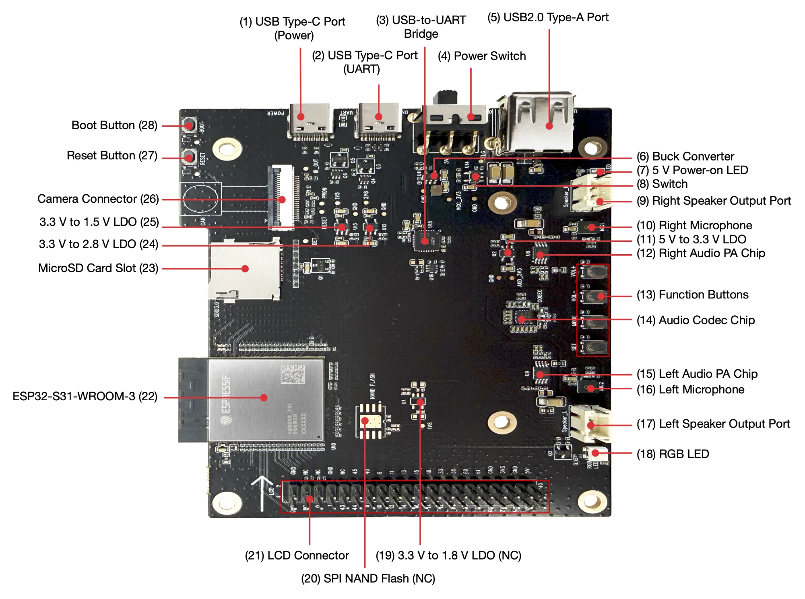
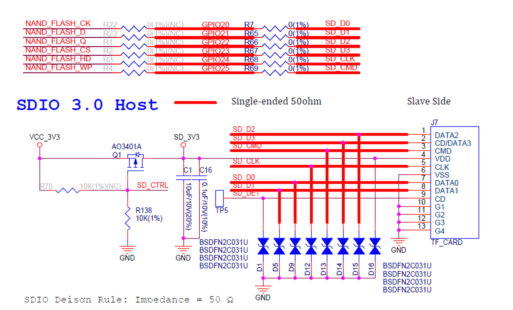

# ESP32-S31-Korvo-1 microSD USB High-Speed MSC 속도 측정

ESP32-S31-Korvo-1의 microSD 카드를 USB 2.0 High-Speed MSC로 PC에 연결한다.
그 상태에서 읽기·쓰기 속도를 잰다. 64 GB 이상 SDXC 카드의 exFAT을 지원한다.

## 웹 플래셔

**<https://firepooh.github.io/ESP32S31-SDCARD/>**

1. 데스크톱 Chrome이나 Edge로 연다.
2. Korvo-1의 Type-C UART 포트를 PC에 연결한다.
3. 버전을 고르고 **연결** → **플래시**를 누른다.

바이너리와 esptool 명령은 [Releases](https://github.com/firepooh/ESP32S31-SDCARD/releases)에 있다.

## 사용 보드

| 항목 | 내용 |
|---|---|
| 보드 | [ESP32-S31-Korvo-1 V1.1](https://docs.espressif.com/projects/esp-dev-kits/en/latest/esp32s31/esp32-s31-korvo-1/user_guide.html) (ESP32-S31-WROOM-3, 플래시 16 MB, PSRAM 16 MB) |
| SD 카드 | 64 GB 이상 microSDXC, exFAT (FAT32도 가능) |
| 개발 환경 | ESP-IDF v6.1, esp_tinyusb 2.2.0 |



| 번호 | 부분 | 용도 |
|---|---|---|
| (2) | USB Type-C 포트 (UART) | 전원, 플래시, 콘솔 (COM 포트) |
| (4) | 전원 스위치 | 보드 5 V 전원 |
| (5) | USB 2.0 Type-A 포트 | USB High-Speed MSC (PC 연결) |
| (22) | ESP32-S31-WROOM-3 | MCU 모듈 |
| (23) | microSD 카드 슬롯 | 측정 대상 카드 (SDMMC 슬롯 0, UHS-I) |

사진 출처: Espressif ESP32-S31-Korvo-1 V1.1 사용자 가이드

## 벤치 결과

2026-11-10에 측정했다. MB/s는 1 MB = 10^6 B 기준이다.

| 항목 | 내용 |
|---|---|
| 보드 | ESP32-S31-Korvo-1 V1.1, CPU 320 MHz |
| 카드 | 삼성 microSDXC 512 GB (CID PNM "EF8S5", SD 3.0, UHS-I, AU 4 MB) |
| 파일시스템 | exFAT, 클러스터 256 KiB, 데이터 영역 4 MB 정렬 |
| SD 버스 | 4비트. High Speed 40 MHz(3.3 V 신호)와 UHS-I SDR50 100 MHz(1.8 V 신호)를 비교했다 |
| 펌웨어 | 이 저장소, ESP-IDF v6.1 |

### 원시 순차 읽기 (`rawread`)

카드 중간 위치에서 SD 명령 크기별로 64 MiB 또는 5초씩 읽었다.

| SD 명령 크기 | High Speed 40 MHz (MB/s) | UHS-I SDR50 100 MHz (MB/s) | SDR50 / HS |
|---|---|---|---|
| 4 KiB | 10.68 | 13.69 | 1.3배 |
| 16 KiB | 15.98 | 29.54 | 1.8배 |
| 32 KiB | 17.54 | 36.27 | 2.1배 |
| 64 KiB | 18.44 | 41.54 | 2.3배 |
| 128 KiB | 18.92 | 44.87 | 2.4배 |
| 256 KiB | 19.18 | 46.69 | 2.4배 |
| 512 KiB | 19.30 | 47.61 | 2.5배 |
| 1024 KiB | **19.37** | **48.08** | 2.5배 |
| 버스 이론 상한 | 20 | 50 | 2.5배 |

- 명령이 크면 버스 상한의 96~97 %가 나온다.
- 명령이 작으면 고정 시간 때문에 느리다. 4 KiB 명령 한 번에 HS 384 µs, SDR50 299 µs가 걸렸다.

### exFAT 파일 쓰기·읽기 (`filebench -s 1024`)

1 GiB 파일을 256 KiB씩 쓰고 다시 읽은 뒤 데이터를 검증했다.

| 모드 | 쓰기 (MB/s) | 읽기 (MB/s) | 데이터 검증 |
|---|---|---|---|
| High Speed 40 MHz | 14.48 | 18.91 | OK |
| UHS-I SDR50 100 MHz | **29.15** | **45.58** | OK |

- 256 KiB 쓰기 한 번: SDR50 약 9.0 ms(버스 5.2 ms + 카드 기록 약 3.7 ms)
- 256 KiB 쓰기 한 번: HS 약 18.1 ms(버스 13.1 ms + 카드 기록 약 5.0 ms)
- SDR50 읽기 29,605회(1,611 MB), 쓰기 4,103회(1,074 MB) 동안 SD 오류는 없었다.

### USB MSC 속도 (PC에서 측정)

SDR50, USB High-Speed 연결에서 `python tools\msc_bench.py D:`로 쟀다.
1 GiB 파일, 1 MiB I/O, Windows 캐시 미사용, 3회 반복, 데이터 검증 조건이다.

| MSC 경로 | PC 쓰기 (MB/s) | PC 읽기 (MB/s) |
|---|---|---|
| esp_tinyusb 기본 경로 (`BENCH_MSC_FAST_IO=n`) | 9.01 | 13.65 |
| **MSC 엔진: 미리 읽기 + 쓰기 모으기 (기본값)** | **21.29** | **20.23** |
| 배율 | 2.4배 | 1.5배 |

회차별 값이다. 장치 값은 장치 로그의 `[msc] ... session` 요약이다.

| MSC 경로 | 회차 | PC 쓰기 | PC 읽기 | 장치 쓰기 | 장치 읽기 | 검증 |
|---|---|---|---|---|---|---|
| 기본 경로 | 1 | 9.13 | 13.56 | 9.09 | 13.26 | OK |
| 기본 경로 | 2 | 8.90 | 13.71 | 8.87 | 13.40 | OK |
| 기본 경로 | 3 | 9.01 | 13.69 | 8.99 | 13.42 | OK |
| MSC 엔진 | 1 | 21.38 | 20.22 | 21.19 | 19.42 | OK |
| MSC 엔진 | 2 | 21.23 | 20.23 | 20.99 | 19.43 | OK |
| MSC 엔진 | 3 | 21.26 | 20.23 | 20.99 | 19.45 | OK |

측정 구간의 SD 통계(`stats`):

| 항목 | 기본 경로 읽기 | 기본 경로 쓰기 | 엔진 읽기 | 엔진 쓰기 |
|---|---|---|---|---|
| SD 명령당 평균 크기 | 32 KiB | 32 KiB | 244.9 KiB | 508.4 KiB |
| SD busy (전체 시간 중 SD 명령 시간) | 41 % | 79 % | 42 % | 60 % |
| SD 명령 시간만으로 계산한 속도 | 32.5 MB/s | 11.4 MB/s | 45.8 MB/s | 34.9 MB/s |
| SD 오류 | 0 | 0 | 0 | 0 |

엔진 카운터: 미리 읽기 적중 98,368회, 실패 77회, 대기 8회, 버린 미리 읽기 0회.
쓰기 모으기는 SD 명령 6,188회, 주소 불연속으로 끊긴 경우 39회, PC 대기 42회였다.

32 KiB 한 덩어리를 처리하는 시간:

| 구간 | 기본 경로 | MSC 엔진 |
|---|---|---|
| 읽기 | 2.40 ms = SD 1.01 ms + USB 쪽 1.39 ms (차례로 처리) | 1.62 ms |
| 쓰기 | 3.64 ms, 그중 SD 2.87 ms (전송 0.66 ms + 카드 기록 약 2.2 ms) | 1.54 ms |

- 기본 경로는 SD 읽기와 USB 전송이 겹치지 않고, 32 KiB 쓰기마다 카드 기록 시간이 붙는다.
- MSC 엔진은 256 KiB씩 미리 읽고, 쓰기를 512 KiB까지 모아 SD 명령 하나로 쓴다.
- 엔진 적용 뒤 병목은 USB 쪽이다. 그중 약 0.3 ms는 PSRAM과 내부 RAM 사이 memcpy다(297 µs, 287 µs).

## UHS-I SDR50

SDR50은 1.8 V 신호, 100 MHz 클럭, 4비트로 동작한다. 버스 상한은 100 MHz × 4 ÷ 8 = 50 MB/s다.

| 모드 | 신호 전압 | 클럭 | 샘플링 | 버스 상한 | ESP32-S31 (IDF v6.1) |
|---|---|---|---|---|---|
| Default Speed | 3.3 V | 25 MHz (IDF는 20 MHz) | 상승 에지 | 12.5 MB/s | 지원 |
| High Speed | 3.3 V | 50 MHz (IDF 기본 40 MHz) | 상승 에지 | 25 MB/s | 지원 |
| UHS-I SDR50 | 1.8 V | 100 MHz | 상승 에지 | 50 MB/s | 지원, 이 보드에서 확인 |
| UHS-I DDR50 | 1.8 V | 50 MHz | 상승·하강 에지 | 50 MB/s | 드라이버 미지원 |
| UHS-I SDR104 | 1.8 V | 208 MHz | 상승 에지 | 104 MB/s | 드라이버 미지원 |

- 카드가 UHS-I를 지원해야 한다. 이번 카드는 1.8 V 요청에 S18A=1로 답했다.
- S31은 CMD11 때 SD 패드 전원을 칩 내부 LDO(1.8 V)로 바꾼다. 보드에 레벨 시프터가 필요 없다.
- 카드는 전원이 새로 들어온 직후에만 1.8 V 전환을 받는다. 그래서 부팅 때마다 GPIO39로 카드 전원을 1초 끊는다.
- 카드가 전환을 거절하면 High Speed 40 MHz로 내려가고 경고를 남긴다.

```
I sd: card power cycled with GPIO39 (off 1000 ms, on level 0)
I sd: slot 0, 4-bit, requested mode: UHS-I SDR50 100 MHz
I sdmmc_sd: sdmmc_do_timing_tuning: proper delay phase/line id: 2
Type: SDHC/SDXC (UHS-I)
Bus: 4-bit, UHS-I SDR50 100 MHz, UHS-I active, clock 100000 kHz (card limit 100000 kHz)
OCR: 0xc1ff8000 (CCS 1, S18A 1) | host sent S18R: yes
```

## 보드 연결

| 항목 | 내용 |
|---|---|
| microSD | SDMMC 슬롯 0, 4비트. CLK GPIO24, CMD GPIO25, D0~D3 GPIO20~23 |
| SD_CTRL | GPIO39. 카드 전원 스위치 Q1(AO3401A) 게이트. LOW = 켜짐 |
| USB MSC | USB 2.0 Type-A 포트 (High-Speed OTG) |
| 콘솔 | Type-C UART 포트 (UART0), 115200 bps |



회로도 출처: Espressif ESP32-S31-Korvo-1 V1.1 회로도 ("SDIO 3.0 Host" 블록)

- 신호선은 0 Ω 저항만 거쳐 카드에 바로 연결된다. 외부 풀업이 없어 칩 내부 풀업을 쓴다.
- 카드 감지(SD_DET)는 TP5에만 연결돼 있어 쓰지 않는다.

> **주의:** Type-A 포트는 원래 호스트용이라 보드가 5 V를 내보낸다.
> PC에 연결할 때는 VBUS를 끊은 케이블이나 어댑터를 쓴다.

## 빌드와 릴리즈

```powershell
. C:\Espressif\tools\Microsoft.v6.1.PowerShell_profile.ps1
idf.py --preview build
idf.py --preview -p COM4 flash monitor
```

ESP32-S31은 IDF v6.1에서 프리뷰 타깃이라 `--preview`가 필요하다.

`v*` 태그를 푸시하면 GitHub Actions가 빌드해 릴리즈와 웹 플래셔를 갱신한다.

```bash
git tag v1.0.1
git push origin v1.0.1
```

- `-`가 들어간 태그(`v1.1.0-rc1`)는 프리릴리즈가 된다.
- `dependencies.lock`으로 esp_tinyusb 2.2.0을 고정한다. MSC 엔진이 내부 함수를 가로채므로 버전을 바꾸면 안 된다.

## 사용법

### PC에서 측정

```powershell
python tools\msc_bench.py E:
```

- 기본은 1 GiB 파일, 1 MiB I/O, 3회 반복, Windows 캐시 미사용, 데이터 검증이다.
- 이동식 드라이브가 아니면 실행하지 않는다.

측정 중 장치 콘솔에 1초마다 처리량이 나온다.
SD busy가 100 %에 가까우면 SD 쪽, 낮으면 USB 쪽이 병목이다.

```
[msc] RD  xx.xx MB/s (SD busy  xx%) | WR  xx.xx MB/s (SD busy  xx%)
```

### 장치 단독 측정

PC에서 드라이브를 꺼낸 뒤 실행한다.

```
s31> mount
s31> rawread
s31> filebench -s 1024
s31> expose
```

### 콘솔 명령

| 명령 | 설명 |
|---|---|
| `info` | 카드 레지스터, 버스 모드와 클럭, USB 속도, 파일시스템 |
| `mount` / `expose` | 카드를 앱으로 가져온다 / PC에 돌려준다 |
| `stats [on\|off\|reset]` | USB·SD 통계 |
| `rawread [-s MiB] [-c KiB] [-o MiB]` | 원시 순차 읽기 |
| `filebench [-s MiB] [-b KiB] [-n] [-k]` | 파일 쓰기·읽기·검증 |
| `format [-t exfat\|fat32] [-c KiB] --yes` | 카드 전체 포맷 (데이터 삭제) |
| `restart` | 칩 재시작 |

### menuconfig (`S31 SD MSC benchmark`)

| 항목 | 기본값 | 설명 |
|---|---|---|
| SD bus speed mode | UHS-I SDR50 100 MHz | Default 20 MHz, High Speed 40/50 MHz도 고를 수 있다 |
| Power-cycle the card with a GPIO | 켬 | UHS-I에 필요하다 |
| MSC read-ahead and write merging | 켬 | 끄면 esp_tinyusb 기본 경로 |
| Read-ahead / Write merge buffer size | 256 KiB / 512 KiB | 각각 2개, PSRAM |
| Write back merged data after this host idle time | 20 ms | 이 시간 동안 쓰기가 없으면 카드에 기록 |

## 구현 메모

- **exFAT**: IDF v6.1 fatfs를 `components/fatfs`로 복사해 `FF_FS_EXFAT`를 1로 바꿨다. IDF 버전을 바꾸면 다시 복사한다.
- **카드 소유권**: `mount`와 `expose`로만 바뀐다. 앱이 카드를 쓰는 동안 PC에는 "매체 없음"으로 응답한다.
- **링커 래퍼**: `-Wl,--wrap`으로 TinyUSB MSC 콜백과 `sdmmc_read/write_sectors`를 감싼다.
- **write-back 주의**: 쓰기 직후 20 ms 안에 전원이 끊기면 최대 1 MiB를 잃을 수 있다.

## 파일 구성

```
main/                     app_main, sd_card, msc_ctrl, msc_io(MSC 엔진), bench, cmd_bench
components/fatfs/         IDF v6.1 fatfs 복사본 (exFAT 켬)
tools/msc_bench.py        PC 측 속도 측정 (Windows)
web/index.html            웹 플래셔 (esptool-js)
.github/workflows/        release.yml (태그 빌드), pages.yml (웹 플래셔 배포)
docs/images/              보드 사진, microSD 회로도
```

## 확인하지 않은 것

- Type-A 포트를 PC에 연결할 때의 VBUS 처리
- SD 신호선의 실제 1.8 V 진폭 (오실로스코프)
- High Speed 50 MHz 동작
- 웹 플래셔로 실제 보드에 굽기
